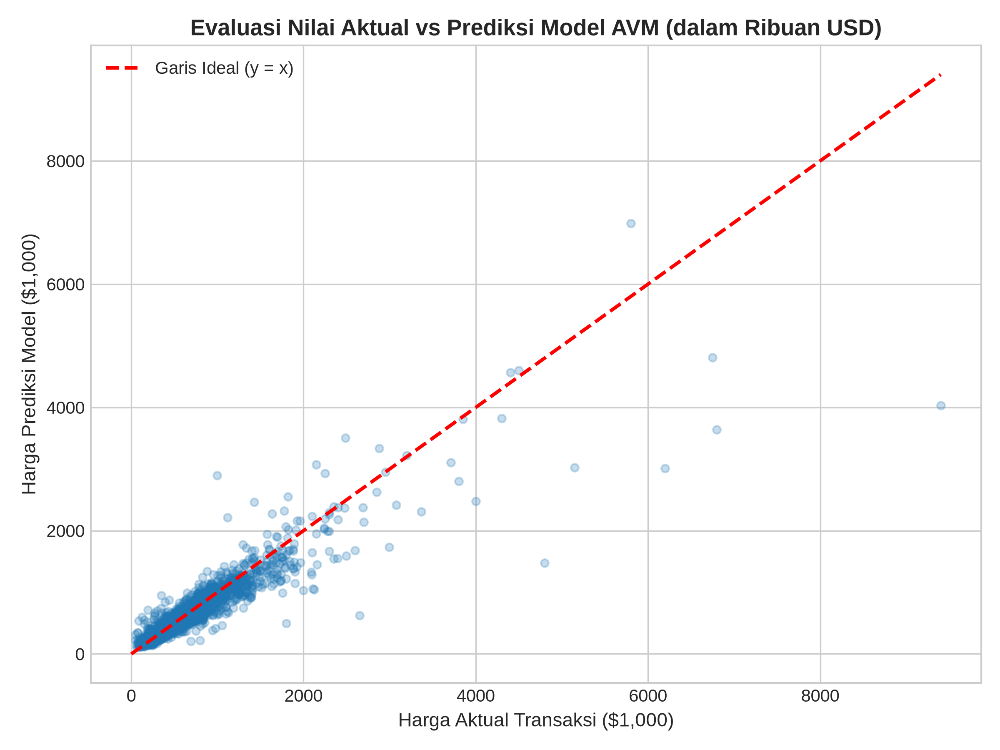
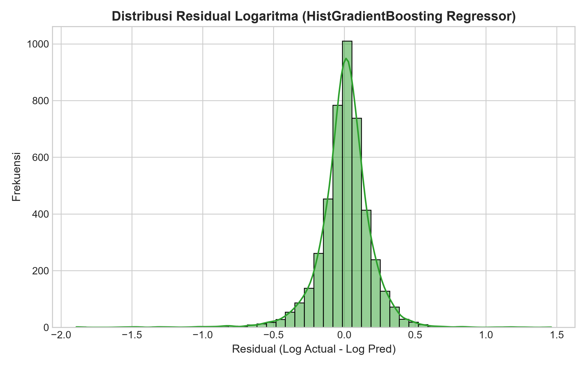
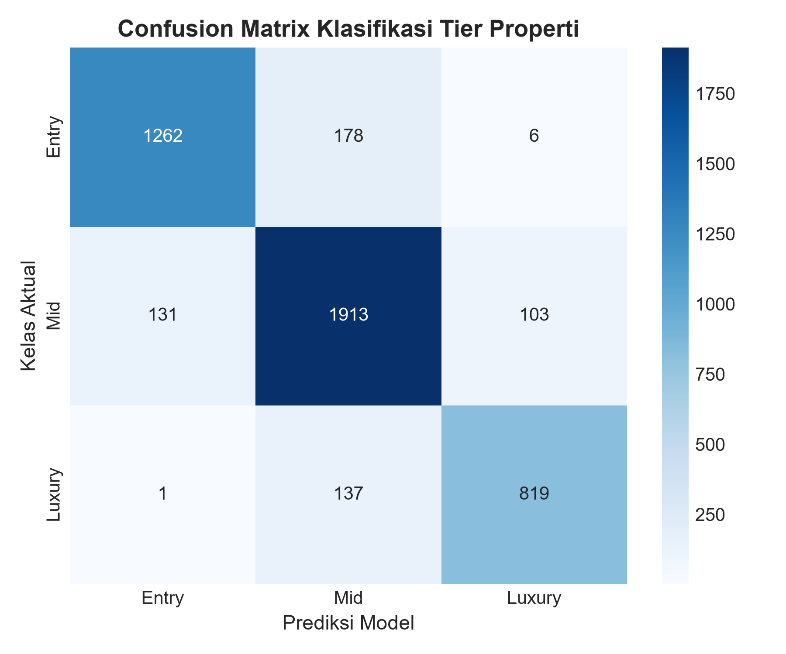
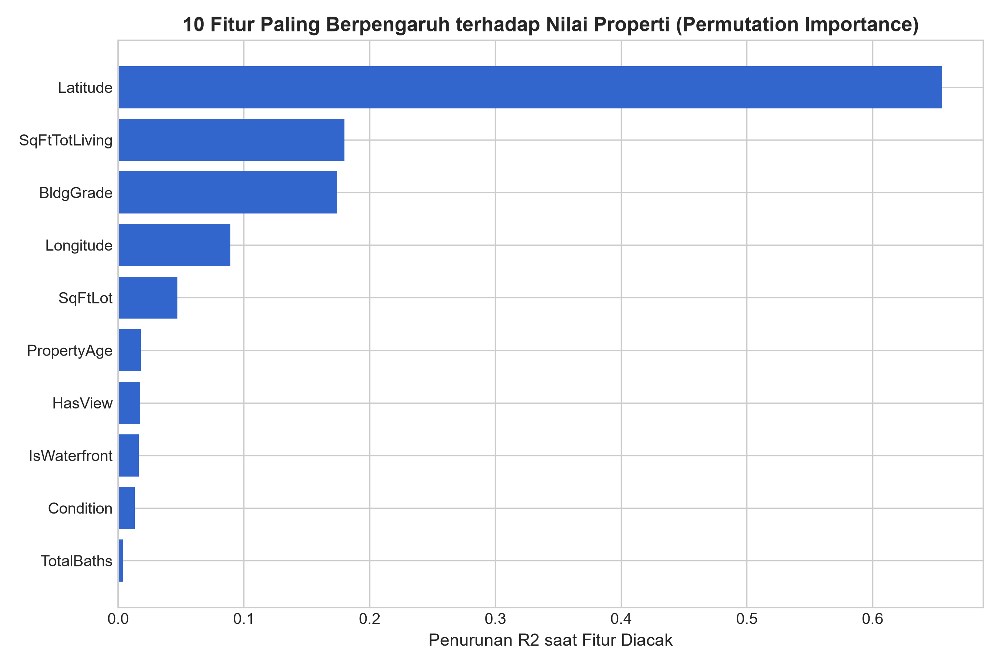
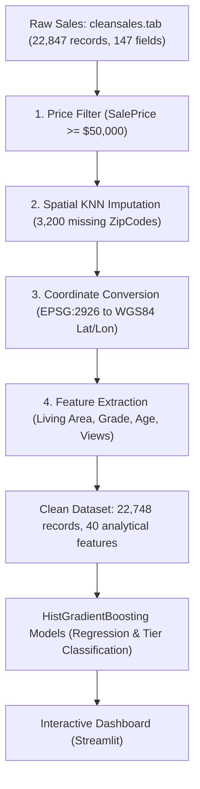

# King County Automated Valuation Model (AVM)

[](https://www.python.org/)
[](https://scikit-learn.org/)
[](https://streamlit.io/)
[](LICENSE)
[](https://doi.org/10.7910/DVN/VUAIMQ)

An automated property valuation and spatial analysis system trained on 22,748 residential transactions across King County, Washington. The system pairs gradient boosted hedonic regression with geographic coordinates to predict market values, classify price tiers, and quantify the price impact of location and structural attributes.

---

## Overview

Traditional property appraisal requires manual inspection, costs between $400 and $800 per property, and takes multiple weeks. This project provides automated valuations in under a second using open transaction records from the King County Department of Assessments.

The valuation engine estimates fair market prices with a median absolute percentage error of 13.39%, classifies homes into three market tiers with 87.78% accuracy, and ranks the primary drivers of housing prices through permutation feature importance.

---

## Valuation model performance

The modeling dataset contains 22,748 verified single-family home transactions after filtering out non-market transfers. Models were evaluated on an 80/20 train-test split (18,198 training sales and 4,550 test sales) stratified by property price tier.

### Hedonic regression benchmark

The target variable is natural log sale price, $\ln(\text{SalePrice})$, which stabilizes the variance of right-skewed prices ranging from $50,000 to $9,400,000. Predictions are transformed back to dollars via exponentiation.

| Model | $R^2$ (Log Scale) | RMSE (Log Scale) | MAPE (%) | MAE (USD) | Role |
| :--- | :---: | :---: | :---: | :---: | :--- |
| OLS Linear Regression | 0.7460 | 0.2860 | 22.04% | $124,551 | Parametric baseline |
| Ridge Regression ($L_2$) | 0.7460 | 0.2859 | 22.01% | $124,387 | Regularized baseline ($L_2$ shrinkage) |
| Lasso Regression ($L_1$) | 0.7458 | 0.2861 | 22.05% | $124,637 | Sparse regularized linear ($L_1$ penalty) |
| Elastic Net Regression | 0.7460 | 0.2860 | 22.03% | $124,510 | Hybrid regularized linear ($L_1 + L_2$) |
| Decision Tree Regressor | 0.8168 | 0.2429 | 17.60% | $98,721 | Single non-linear tree baseline |
| Random Forest Regressor | 0.8659 | 0.2078 | 14.33% | $79,623 | Tree ensemble (bagging) |
| **HistGradientBoosting Regressor** | **0.8848** | **0.1926** | **13.39%** | **$72,329** | **Selected production model** |

The HistGradientBoosting regressor outperforms the linear baseline across all evaluation metrics. It reduces Mean Absolute Error by $52,222 per home (a 41.9% reduction in absolute dollar error compared to OLS) and explains 88.48% of the log-price variance on unseen data.



Residuals from the selected model center tightly around zero with near-normal symmetry, confirming that the log transformation controls heteroscedasticity across low and high price bands.



### Market tier classification

In addition to continuous price predictions, market segmentation classifiers were benchmarked to categorize properties into three tiers:
- Entry-Level: below $350,000
- Mid-Market: $350,000 to $700,000
- Luxury: above $700,000

| Classifier Model | Accuracy (%) | Macro F1-Score | Role |
| :--- | :---: | :---: | :--- |
| Decision Tree Classifier | 83.52% | 0.8350 | Non-linear tree baseline |
| Random Forest Classifier | 85.96% | 0.8568 | Ensemble bagging |
| **HistGradientBoosting Classifier** | **87.78%** | **0.8774** | **Selected production classifier** |

On the 4,550 held-out test transactions, the production HistGradientBoosting classifier reached **87.78% overall accuracy** and a **macro F1-score of 0.8774**.



---

## Empirical findings on price drivers

Permutation importance measures how much the test $R^2$ drops when each feature is randomly shuffled. The results highlight the dominant role of geography and construction quality over raw room counts.



### 1. Geographic coordinates dominate valuation
Latitude is the single strongest factor in the model (importance score 0.6566), followed by longitude (0.0929). North-south coordinate placement creates stark price differentials across the county:
- Northern tech corridors (Bellevue, Redmond, Kirkland, and North Seattle) command significant premiums. Medina (zip code 98039) records a median price of $2,187,730, and Mercer Island (98040) records $1,042,000.
- Southern municipalities show much lower price levels for comparable square footage. Pacific and Auburn (98002) have a median price of $235,000, and Tukwila (98168) records $232,000.

### 2. Finished living area and construction grade
Total living area (`SqFtTotLiving`, score 0.1849) is the primary physical dimension determining value. Building grade (`BldgGrade`, score 0.1591), assigned on a 1 to 13 craftsmanship scale by county assessors, produces steep non-linear price steps. High-grade construction (grades 10 to 13) frequently doubles estimated value relative to standard-grade homes of identical square footage.

### 3. Lot size, water frontage, and views
Lot area (`SqFtLot`, score 0.0487), panoramic views (`HasView`, score 0.0169), and waterfront frontage (`IsWaterfront`, score 0.0167) add substantial premiums. Waterfront parcels along Lake Washington and Puget Sound hold the highest price per square foot across the county.

### 4. Limited marginal impact of bedroom counts
Bedroom count (`Bedrooms`, score 0.0004) has almost no independent effect once living area, bathroom count, and building grade are accounted for. Adding a bedroom without expanding total living space does not meaningfully increase property value.

---

## Data pipeline and spatial methodology



The pipeline prepares raw assessment files through five reproducible stages:

1. **Filtering:** Records below $50,000 were removed to eliminate intra-family transfers, foreclosures, and non-market recordings, yielding 22,748 valid market transactions.
2. **Coordinate conversion:** Raw coordinates recorded in the Washington State Plane North coordinate system (EPSG:2926, US Survey Feet) were converted to standard WGS84 latitude and longitude (EPSG:4326) using conformal conic transformations.
3. **Spatial imputation:** Nearest neighbor spatial matching resolved 3,200 missing postal codes by referencing the nearest physical coordinate clusters.
4. **Target scaling:** Sale prices span from $50,000 to $9,400,000 with heavy right skew. Natural log transformation stabilized variance for model fitting.
5. **Dimensionality selection:** 18 direct predictors were selected from the 147 original fields to prevent multicollinearity and data leakage.

---

## Quickstart

### 1. Environment setup

```bash
python3 -m venv venv
source venv/bin/activate
pip install -r requirements.txt
```

### 2. Launch the applications

#### Streamlit Desktop App
```bash
streamlit run app/app.py
```
The interface opens at `http://localhost:8501`.

#### Modern Aeris Web Dashboard (SPA)
Open `web/index.html` directly in your browser, or serve it locally:
```bash
python3 -m http.server 8000 -d web
```
The interface opens at `http://localhost:8000`. Features:
- **Smart Valuator:** Instant AVM property valuation with SHAP attribution bars.
- **Market Explorer:** Spatial visualization across King County micro-markets.
- **Renovation Simulator:** Real-time ROI and value-add equity calculator.
- **Quality & Audit Report:** Comprehensive IAAO/USPAP compliance and 7-model econometric scorecard.

### 3. Reproduce data pipeline and training

```bash
# Clean raw transaction records:
PYTHONPATH=. python3 src/data_processing.py

# Train models, compute metrics, and export figures:
PYTHONPATH=. python3 src/modeling.py
```

---

## License and data source

This project is released under the [MIT License](LICENSE).

Property sales and assessment records are sourced from the King County Department of Assessments and the University of Washington via the [Harvard Dataverse](https://doi.org/10.7910/DVN/VUAIMQ).
