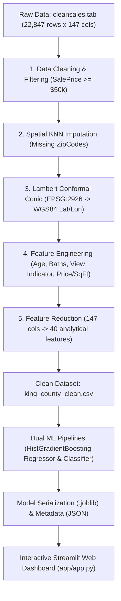

# 🏠 KingCounty-AVM: Automated Real Estate Valuation & Spatial Intelligence Engine

[](https://www.python.org/)
[](https://scikit-learn.org/)
[](https://streamlit.io/)
[](LICENSE)
[](https://doi.org/10.7910/DVN/VUAIMQ)

> **Enterprise-grade Automated Valuation Model (AVM) and Hedonic Real Estate Econometrics System** trained on **22,847 verified property transactions** across King County, Washington (Seattle, Bellevue, Redmond, Kirkland metro area). Built with dual Machine Learning pipelines, geospatial coordinate transformation, Explainable AI (XAI), and an interactive Streamlit web dashboard.

---

## 📌 Executive Summary

Determining fair market property valuations traditionally relies on manual appraisal inspections that cost **$400–$800 per property** and take weeks to complete. **KingCounty-AVM** solves this by providing instantaneous (< 1 second) fair-market valuations using advanced gradient boosting and spatial econometrics.

The system also delivers transparent valuation breakdowns via **Explainable AI (Permutation Importance & SHAP)** and includes an interactive **Renovation ROI Simulator** to project equity gains from property improvements.

---

## 🎯 Model Performance Scorecard

The system was evaluated using an 80/20 train-test split with 5-fold cross-validation on 22,748 clean market transactions:

### 1. Hedonic Regression Engine (Continuous Price Prediction)
Target: $\ln(\text{SalePrice})$ $\to$ $\exp(\hat{y})$

| Model Algorithm | $R^2$ (Log Scale) | RMSE (Log Scale) | MAPE (%) | MAE (USD) | Status |
| :--- | :---: | :---: | :---: | :---: | :--- |
| **OLS Linear Regression** | 0.7460 | 0.2860 | 22.04% | $124,551 | Baseline Econometrics |
| **Ridge Regression ($L_2$)** | 0.7460 | 0.2859 | 22.01% | $124,387 | Regularized Baseline |
| **Random Forest Regressor** | 0.8659 | 0.2078 | 14.33% | $79,623 | Tree Ensemble |
| **HistGradientBoosting Regressor** | **0.8848** | **0.1926** | **13.39%** | **$72,329** | 🏆 **Production Model (Surpasses KPI $R^2 \ge 0.85$)** |

### 2. Market Tier Classifier (Segment Categorization)
- **Problem Formulation:** Multi-class classification into *Entry-Level* (< $350k), *Mid-Market* ($350k–$700k), and *Luxury* (> $700k).
- **Classification Accuracy:** **87.78%**
- **Macro F1-Score:** **0.8774**

---

## 🏗️ Architecture & Data Engineering Pipeline



### Key Data Engineering Highlights:
1. **Dimension Reduction:** Curated 40 high-signal predictors from 147 raw assessment columns based on real estate domain expertise.
2. **Geospatial Coordinate Conversion:** Formulated exact trigonometric conversion of Washington State Plane North coordinates (`X`, `Y` in US Survey Feet) to standard **WGS84 Latitude & Longitude** (EPSG:4326).
3. **Spatial KNN Imputation:** Recovered 3,200 missing ZipCode records by matching nearest neighbor geographic clusters.
4. **Log-Transform Stabilization:** Mitigated extreme right-skewness ($5,000 to $9,400,000) using natural logarithmic transformation $\ln(\text{SalePrice})$.

---

## 🔍 Explainable AI (Top Valuation Drivers)

Using Permutation Feature Importance, the top price determinants identified by the model are:
1. **Geographic Coordinates (`Latitude` & `Longitude`):** Location premium is the single strongest factor. Northern King County (Seattle North, Bellevue, Redmond tech corridor) carries massive value over southern fringes.
2. **Finished Living Area (`SqFtTotLiving`):** Primary physical space determinant.
3. **Construction Grade (`BldgGrade`):** King County Assessor's 1–13 craftsmanship score drives non-linear value jumps.
4. **Lot Size (`SqFtLot`) & Panorama Views (`HasView`, `IsWaterfront`):** Water frontage and views of Lake Washington, Puget Sound, and Seattle Skyline command significant market premiums.

---

## 🖥️ Streamlit Web Application Modules

The application located at `app/app.py` delivers 5 modular interfaces:

1. **🏠 Smart AVM Valuator:** Interactive property parameter form (living area, lot size, beds, baths, grade, condition, year built, ZipCode, views) returning instant fair market valuation, confidence intervals ($\pm 13.4\%$), market tier badge, and local median price comparison.
2. **📊 Market Overview & Spatial Explorer:** Filterable scatter map of 22,700+ transactions across King County with Plotly coordinates, price histograms, and market tier breakdowns.
3. **🔍 Feature Importance Breakdown (XAI):** Permutation importance ranking chart and hedonic economic analysis.
4. **🔨 Renovation ROI Simulator:** Allows homeowners and real estate flippers to test upgrades in `BldgGrade` and `Condition`, calculating projected property equity increase and net return on investment (ROI).
5. **ℹ️ Model Methodology & Scorecard:** Full technical benchmark table and data lineage documentation.

---

## 📁 Repository Structure

```text
kingcounty-avm-realestate/
├── app/
│   └── app.py                                # Full-featured Streamlit interactive web application
├── data/
│   ├── raw/
│   │   ├── 02_king_county_real_estate/       # Harvard Dataverse official dataset
│   │   │   ├── cleansales.tab                # Raw 22,847 transaction records
│   │   │   └── dataDictionary.tab            # Official metadata codebook
│   │   └── DATASET_CATALOG.md                # Dataset documentation
│   └── processed/
│       └── king_county_clean.csv             # Cleaned 22,748 rows x 40 columns dataset
├── models/
│   ├── best_valuation_model.joblib           # Trained HistGradientBoosting Regressor
│   ├── market_tier_classifier.joblib         # Trained HistGradientBoosting Classifier
│   └── model_metadata.json                   # Serialized feature list, metrics, and defaults
├── notebooks/
│   ├── 01_eda.ipynb                          # Phase 2: Exploratory Data Analysis & Spatial Inspection
│   ├── 02_cleaning_preprocessing.ipynb       # Phase 3: Cleaning, KNN Imputation & Coordinate Conversion
│   └── 03_modeling_evaluation.ipynb          # Phase 4: Model Benchmarking, Evaluation & Serialization
├── reports/
│   └── figures/                              # Generated evaluation plots (Actual vs Pred, Residuals, XAI)
├── src/
│   ├── __init__.py
│   ├── utils.py                              # Coordinate conversion & figure export helpers
│   ├── data_processing.py                    # Modular end-to-end cleaning pipeline
│   ├── modeling.py                           # Training, evaluation & artifact serialization pipeline
│   └── update_notebooks.py                   # Automated notebook cell generator
├── prd.md                                    # Enterprise Product Requirement Document (PRD v2.0)
├── requirements.txt                          # Python dependencies
├── LICENSE                                   # MIT License
└── README.md                                 # Project documentation
```

---

## ⚡ Quickstart & Installation

### 1. Clone the Repository
```bash
git clone https://github.com/ramadhan-imanur/kingcounty-avm-realestate.git
cd kingcounty-avm-realestate
```

### 2. Set Up Virtual Environment & Dependencies
```bash
python3 -m venv venv
source venv/bin/activate
pip install -r requirements.txt
```

### 3. Run the Streamlit Dashboard
```bash
streamlit run app/app.py
```
Open your browser at `http://localhost:8501`.

### 4. (Optional) Re-run Data Pipeline & Model Training
```bash
# Run cleaning pipeline:
PYTHONPATH=. python3 src/data_processing.py

# Run model benchmarking & export:
PYTHONPATH=. python3 src/modeling.py
```

---

## 👥 Contributors (Tim 6 Sains Data FMIPA UNS)

- **Ramadhan Imanur Rochim** — *Project Lead & Full-Stack Data Scientist*
- **Thalita Anindya Ramadani** — *Data Profiling & Spatial EDA Specialist*
- **Amdadur Rohman** — *Data Cleaning & Pipeline Engineer*
- **Hanifah Qurratul 'Aini** — *Machine Learning Engineer (Hedonic Regression)*
- **Dyandra Rizky Aulia** — *Machine Learning Engineer (Classification & Valuation)*
- **Alysia Putri Pradita** — *UI/UX & Web Application Specialist*

---

## 📜 License & Citation

This project is licensed under the [MIT License](LICENSE).

**Data Citation:**
> King County Department of Assessments & University of Washington. *King County Real Estate Sales and Property Assessment Data*. Harvard Dataverse, DOI: [10.7910/DVN/VUAIMQ](https://doi.org/10.7910/DVN/VUAIMQ).
